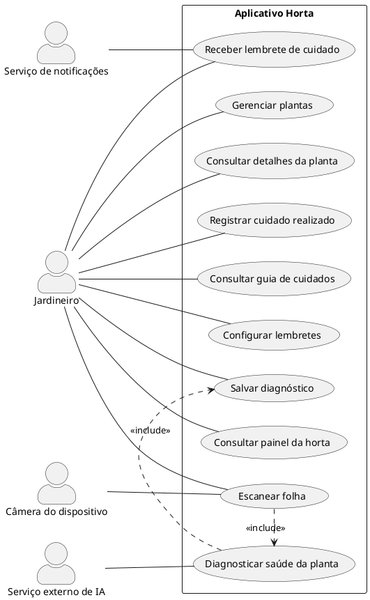

# Diagrama de casos de uso - Horta

> O app Flutter atual possui navegação, planta inicial, registro visual de rega, guia e diagnóstico demonstrativo. Câmera real, persistência, notificações e IA são integrações previstas para transformar esse fluxo em funcionalidade completa.

## Atores identificados

| Ator | Responsabilidade |
| --- | --- |
| Jardineiro | Acompanha a própria horta e toma decisões de cuidado. |
| Câmera do dispositivo | Fornece a imagem da folha durante o escaneamento. |
| Serviço externo de IA | Identifica a planta e analisa possíveis deficiências na imagem. |
| Serviço de notificações | Entrega lembretes de cuidado agendados pelo sistema. |

