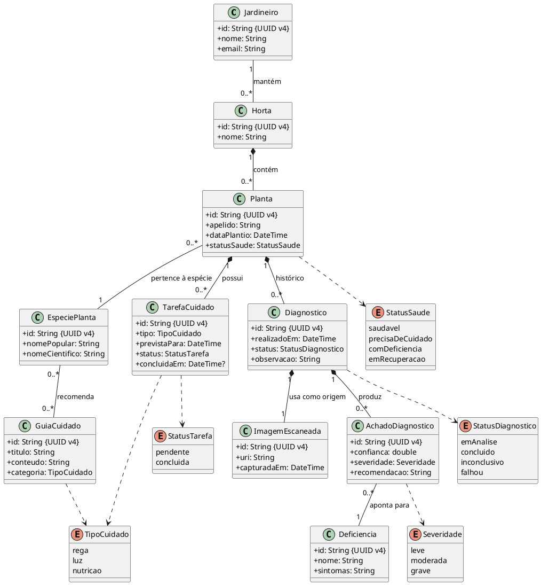

# Diagrama de classes - Horta

Os modelos estão em [modelos_horta.dart](../lib/modelos_horta.dart). O app mantém os objetos em memória durante a sessão. Os identificadores são UUID v4 armazenados como `String`, e `dataPlantio` guarda uma data civil em `DateTime` à meia-noite local. A confiança é uma proporção entre 0 e 1. O scanner de demonstração usa uma URI simbólica e valores fictícios de confiança e severidade.

