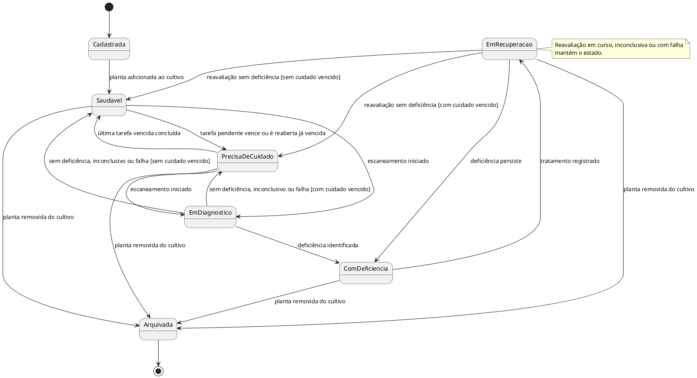

# Diagrama de estados - Planta

`Horta.plantar` cadastra e inclui a planta no cultivo na mesma operação. O
estado `Cadastrada` é transitório. Tarefas pendentes contam como vencidas a
partir do horário previsto, na consulta ao estado.

O UML de referência retorna a `Saudavel` após um resultado inconclusivo.
A implementação mantém o resultado como inconclusivo e aplica a regra de
cuidados vencidos também após uma análise sem deficiência. Se houver pendências,
o destino é `PrecisaDeCuidado`. A mesma verificação vale após uma recuperação
confirmada. Falhas de processamento encerram a análise sem aplicar um resultado
de saúde. Uma reavaliação inconclusiva ou com falha mantém `EmRecuperacao`.
Reabrir uma tarefa vencida produz o mesmo efeito que seu vencimento.

O arquivamento preserva os objetos na horta durante a sessão e os retira do
cultivo ativo. Os dados usam o armazenamento em memória do aplicativo.

