# Diagrama de Componentes e Estrutura de Código - Horta (`lib/main.dart`)

Este diagrama mapeia a árvore de componentes (widgets), telas, estados e classes gráficas implementadas no arquivo principal do projeto ([`lib/main.dart`](../lib/main.dart)).

Ele pode ser colado diretamente em [plantuml.com](https://www.plantuml.com/plantuml/uml/) para geração visual.

```plantuml
@startuml
skinparam classAttributeIconSize 0
skinparam packageStyle rectangle
skinparam shadowing false
skinparam roundcorner 10

title Diagrama Estrutural do Código Flutter - Horta (lib/main.dart)

package "App Core & Shell (Navegação Base)" {
  class HortaApp <<StatelessWidget>> {
    +build(context): Widget
  }
  
  class GardenShell <<StatefulWidget>> {
    +createState(): _GardenShellState
  }
  
  class _GardenShellState <<State>> {
    -_currentIndex: int
    -_watered: bool
    -_openScanner(): void
    -_openPlant(): void
    +build(context): Widget
  }
  
  class _GardenNavigation <<StatelessWidget>> {
    +selectedIndex: int
    +onSelected: ValueChanged<int>
    +build(context): Widget
  }
  
  class _NavItem <<StatelessWidget>> {
    +icon: IconData
    +label: String
    +active: bool
    +onTap: VoidCallback
    +build(context): Widget
  }
}

package "Telas Principais (Bottom Navigation Bar)" {
  class HomePage <<StatelessWidget>> {
    +watered: bool
    +onOpenPlant: VoidCallback
    +onScan: VoidCallback
    +onWater: VoidCallback
    +build(context): Widget
  }
  
  class PlantsPage <<StatelessWidget>> {
    +onOpenPlant: VoidCallback
    +build(context): Widget
  }
  
  class CareGuidePage <<StatelessWidget>> {
    +build(context): Widget
  }
  
  class ProfilePage <<StatelessWidget>> {
    +build(context): Widget
  }
}

package "Telas Modais / Navegação por Rota" {
  class PlantDetailPage <<StatefulWidget>> {
    +isWatered: bool
    +onWaterChanged: ValueChanged<bool>
    +createState(): _PlantDetailPageState
  }
  
  class _PlantDetailPageState <<State>> {
    -_watered: bool
    -_setWatered(): void
    +build(context): Widget
  }
  
  class ScannerPage <<StatefulWidget>> {
    +createState(): _ScannerPageState
  }
  
  class _ScannerPageState <<State>> {
    -_scanned: bool
    +build(context): Widget
  }
}

package "Módulo de Scanner e Diagnóstico Foliar" {
  class _ScannerView <<StatelessWidget>> {
    +onScan: VoidCallback
    +build(context): Widget
  }
  
  class _DiagnosisResult <<StatelessWidget>> {
    +onClose: VoidCallback
    +build(context): Widget
  }
  
  class _ScannerCircle <<StatelessWidget>> {
    +icon: IconData
    +onTap: VoidCallback
  }
  
  class _ResultStep <<StatelessWidget>> {
    +number: String
    +text: String
  }
}

package "Componentes e Cards Reutilizáveis" {
  class _WelcomeCard <<StatelessWidget>>
  class _PlantOverviewCard <<StatelessWidget>>
  class _CareTask <<StatelessWidget>> {
    +done: bool
    +icon: IconData
    +title: String
    +subtitle: String
  }
  class _ScanCallout <<StatelessWidget>>
  class _PlantGridCard <<StatelessWidget>>
  class _AddPlantCard <<StatelessWidget>>
  class _WishlistRow <<StatelessWidget>>
  class _TipHero <<StatelessWidget>>
  class _GuideTile <<StatelessWidget>> {
    +number: String
    +title: String
    +subtitle: String
  }
  class _ProfileStatRow <<StatelessWidget>>
  class _Stat <<StatelessWidget>> {
    +value: String
    +label: String
  }
  class _ProfileOption <<StatelessWidget>> {
    +icon: IconData
    +label: String
  }
  class _PlantMetric <<StatelessWidget>> {
    +icon: IconData
    +label: String
    +value: String
    +color: Color
  }
  class _HealthPill <<StatelessWidget>>
  class _TinyTag <<StatelessWidget>>
  class _SectionHeader <<StatelessWidget>>
  class _RoundIconButton <<StatelessWidget>>
}

package "Renderização Gráfica Vetorial (Procedural Canvas)" {
  class _PlantArtwork <<StatelessWidget>> {
    +size: double
    +potColor: Color
  }
  
  class _PlantPainter <<CustomPainter>> {
    +potColor: Color
    +paint(canvas, size): void
    +shouldRepaint(oldDelegate): bool
  }
  
  class _CameraBackdropPainter <<CustomPainter>> {
    +paint(canvas, size): void
    +shouldRepaint(oldDelegate): bool
  }
}

' Relacionamentos Estruturais
HortaApp *-- GardenShell : define como home
GardenShell *-- _GardenShellState : gerencia estado

_GardenShellState *-- _GardenNavigation : barra inferior acoplada
_GardenShellState *-- HomePage : aba 0 (Início)
_GardenShellState *-- PlantsPage : aba 1 (Plantas)
_GardenShellState *-- CareGuidePage : aba 2 (Guia)
_GardenShellState *-- ProfilePage : aba 3 (Perfil)

_GardenShellState ..> ScannerPage : abre via Navigator (FAB central)
_GardenShellState ..> PlantDetailPage : abre via Navigator (ao tocar no card)

_GardenNavigation *-- "4" _NavItem : compõe botões de navegação

' Detalhes da HomePage
HomePage *-- _WelcomeCard
HomePage *-- _SectionHeader
HomePage *-- _PlantOverviewCard
HomePage *-- _CareTask
HomePage *-- _ScanCallout
_PlantOverviewCard *-- _TinyTag
_PlantOverviewCard *-- _HealthPill
_PlantOverviewCard *-- _PlantArtwork

' Detalhes da PlantsPage
PlantsPage *-- _PlantGridCard
PlantsPage *-- _AddPlantCard
PlantsPage *-- _WishlistRow
_PlantGridCard *-- _HealthPill
_PlantGridCard *-- _PlantArtwork
_WishlistRow *-- _PlantArtwork

' Detalhes da CareGuidePage
CareGuidePage *-- _TipHero
CareGuidePage *-- _GuideTile
_TipHero *-- _PlantArtwork

' Detalhes da ProfilePage
ProfilePage *-- _ProfileStatRow
ProfilePage *-- _ProfileOption
_ProfileStatRow *-- "3" _Stat

' Detalhes da PlantDetailPage
PlantDetailPage *-- _PlantDetailPageState
_PlantDetailPageState *-- _RoundIconButton
_PlantDetailPageState *-- _PlantArtwork
_PlantDetailPageState *-- _HealthPill
_PlantDetailPageState *-- "3" _PlantMetric

' Detalhes do ScannerPage
ScannerPage *-- _ScannerPageState
_ScannerPageState *-- _ScannerView : quando _scanned == false
_ScannerPageState *-- _DiagnosisResult : quando _scanned == true
_ScannerView *-- _ScannerCircle
_ScannerView *-- _PlantArtwork
_ScannerView *-- _CameraBackdropPainter
_DiagnosisResult *-- _CameraBackdropPainter
_DiagnosisResult *-- "2" _ResultStep

' Camada de Desenho Procedural
_PlantArtwork *-- _PlantPainter : executa no CustomPaint

@enduml
```

## Descrição da Arquitetura do Código

1. **Raiz e Shell de Navegação (`HortaApp` e `GardenShell`):**
   - Centraliza o tema com a paleta oficial (`#97BA7F`, `#FFE04E`, `#F8F8F3`, etc.).
   - Mantém os estados compartilhados de sessão (`_currentIndex` para abas e `_watered` para a rega).
   - O `FloatingActionButton` central está configurado em modo `centerDocked`, acoplado ao `BottomAppBar` recortado (`_GardenNavigation`).

2. **Modularidade das Telas:**
   - As 4 abas principais funcionam como widgets independentes (`HomePage`, `PlantsPage`, `CareGuidePage`, `ProfilePage`).
   - Telas modais e rotas com pilha (`Navigator.push`) para `PlantDetailPage` e `ScannerPage`.

3. **Independência Visual (Zero Assets Pesados):**
   - O widget `_PlantArtwork` delega para o `_PlantPainter`, que desenha via Canvas: haste, folhas em curvas de Bézier com tons distintos de verde, vaso e terra.
   - O widget de escaneamento utiliza `_CameraBackdropPainter` para renderizar o fundo com iluminação e folhas simuladas.
